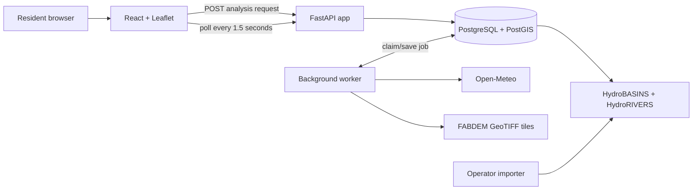

# FloodLens: complete PPT and report reference

This is the single detailed reference for a presentation, report, viva, or
future developer. It records what was built, what was measured, and what must
not be claimed.

## 1. Project summary

**Suggested title:** *FloodLens: Transparent Neighbourhood Flood Awareness
Using Terrain, Rainfall, River-Basin Context, and Research ML Evaluation.*

FloodLens is a local, Docker-based web demonstrator for neighbourhood flood
awareness. A resident clicks a map and selects a 1 km, 2 km, or 5 km local
circle. The application presents real terrain, rainfall, and river-basin
context with explicit coverage and uncertainty messages.

It is not an official warning system, evacuation tool, property-flood
predictor, flood-depth predictor, or flood-probability calculator. The selected
circle is an assessment area, not a watershed.

## 2. Problem and objective

### Problem

Residents can see weather maps, satellite imagery, and nearby rivers, but each
source can be misunderstood. Satellite surface elevation can treat buildings as
terrain. A nearby river may not be connected to a property. A visually simple
score can be mistaken for an official warning.

### Objective

Build an explainable application that combines:

1. bare-earth local terrain information;
2. 48-hour forecast rainfall context;
3. containing/upstream basin and nearby mapped-river context; and
4. honest missing-data and out-of-coverage states.

| Success criterion | Evidence in the project |
| --- | --- |
| Local interactive analysis | Map click, marker, 1/2/5 km selector, job progress |
| Real spatial sources | FABDEM, HydroBASINS, HydroRIVERS, Open-Meteo |
| Reproducible deployment | Docker Compose, PostGIS, source provenance, pinned dependencies |
| Transparent output | Factor cards, coverage flags, no fabricated fallback values |
| Honest ML work | Real labels, whole-event split, saved predictions and metrics |

## 3. Architecture



The app is exposed locally at `127.0.0.1:8000`. PostgreSQL is private to the
Docker network. A worker uses `FOR UPDATE SKIP LOCKED` to ensure that two
workers cannot process the same analysis job.

## 4. User and data pipeline

1. User clicks a map location and selects a radius.
2. React sends latitude, longitude, and radius to FastAPI.
3. FastAPI validates input, creates a UUID job, and stores it in PostGIS.
4. The worker fetches weather, queries basin/river context, and samples local
   terrain.
5. The worker saves structured context and a final status.
6. The frontend polls until the job is complete, waiting for data, or failed.

```text
queued -> running -> complete
                  -> waiting_for_data -> queued after operator import/requeue
                  -> failed
```

`waiting_for_data` and `outside_coverage` are data-integrity features: the
application never invents terrain, weather, basin, or river output.

## 5. Data sources

| Source | Use | Why chosen | Important limit |
| --- | --- | --- | --- |
| FABDEM v1.2 | 30 m bare-earth elevation | Reduces building/tree effects compared with raw surface elevation | Does not model drains, walls, culverts, or sewers |
| HydroBASINS level 8 | Containing basin and upstream area | Gives regional catchment context | Basin membership is not property connectivity |
| HydroRIVERS | Nearby mapped river and distance | Explains river context | River proximity is not proof of flood path |
| Open-Meteo | 48-hour hourly precipitation | Free forecast rainfall context | Not an official alert source |
| OpenStreetMap | Map background | Lets a resident select a place | Not a flood label |
| Sen1Floods11 | Research labels and Sentinel-1 SAR | Real historical event benchmark | Observed water is not a property-flood label |
| CHIRPS v2 | Historical daily rain | 60-day antecedent rainfall sequence | Used only in research, not live forecast cards |

Local imported coverage currently includes Asia HydroBASINS/HydroRIVERS and
Chennai-area FABDEM tiles. This supports a local demo, not worldwide claims.

## 6. Live terrain methodology

FABDEM is sampled inside the selected circle. The worker calculates elevation
position, slope/flatness, local relief, valid-cell coverage, and quality flags.

```text
terrain score = 55% low relative position
              + 25% flatness
              + 20% low local relief
```

| Score | Resident wording |
| ---: | --- |
| 0–33 | Lower relative terrain susceptibility |
| 34–66 | Moderate relative terrain susceptibility |
| 67–100 | Higher relative terrain susceptibility |

The 0–100 value is a deterministic relative terrain index. It is not a flood
probability, calibrated risk percentage, or estimate of water depth.

## 7. Research ML methodology

ML is isolated in `research/` and is not used by the React frontend, FastAPI
API, worker, or resident Docker result.

### Research question

Can observed water/no-water chips from documented flood events be classified
from Sentinel-1 SAR summaries and 60 days of antecedent CHIRPS rainfall while
holding out entire flood events?

### Dataset integrity

| Stage | Actual result |
| --- | ---: |
| S1/hand-label/JRC reference files downloaded | 446 per layer |
| Valid labelled chips | 440 |
| Documented events | 11 |
| Events with complete 60-day rainfall | 10 |
| Chips used by rainfall experiments | 410 |
| Positive observed-water chips before rainfall exclusion | 169 / 440 |

Five chips had no valid `0`/`1` labels and one had no finite SAR values, so all
six were excluded. Spain was excluded from the rainfall experiments because one
historical CHIRPS source pixel was invalid. No missing values were imputed.

### Target and leakage control

The target is `has_observed_water`: at least 5% labelled water in a chip during
a documented event. It is not yet claimed to mean temporary floodwater only;
permanent-water treatment needs further verification.

| Split | Events | Chips | Purpose |
| --- | --- | ---: | --- |
| Train | Bolivia, Sri Lanka, India, Cambodia, Nigeria, Somalia | 199 | Fit model |
| Validation | USA, Paraguay | 135 | Select checkpoint and threshold |
| Test | Ghana, Pakistan | 76 | Final unseen evaluation |

All chips from an event remain in one split. This prevents random pixel/chip
splits from leaking nearby parts of the same flood into both training and test.

### Compared models

| Model | Inputs | Purpose |
| --- | --- | --- |
| Gradient-boosting baseline | Mean Sentinel-1 VV/VH and 1/3/7/14/30/60-day rain totals | Explainable non-linear benchmark |
| Rainfall LSTM | Complete 60-day rainfall sequence plus mean VV/VH | Tests whether rainfall sequence shape helps |

Thresholds from 0.05 to 0.95 were selected only from validation events, then
frozen before the unseen test events were evaluated.

## 8. Metrics and current ML results

| Metric | Meaning |
| --- | --- |
| Precision | Fraction of predicted positives that are correct |
| Recall | Fraction of labelled positives that are found |
| F1 | Balance between precision and recall |
| PR-AUC | Precision/recall quality over thresholds |
| ROC-AUC | Ranking ability over thresholds |
| Confusion matrix | Counts of true/false positives and negatives |

| Held-out metric: 76 unseen chips | Gradient baseline | Rainfall LSTM |
| --- | ---: | ---: |
| Validation-selected threshold | 0.30 | 0.61 |
| F1 | 0.468 | **0.615** |
| Precision | 0.355 | **0.800** |
| Recall | **0.688** | 0.500 |
| PR-AUC | **0.664** | 0.658 |
| ROC-AUC | **0.787** | 0.746 |
| False positives | 20 | **2** |
| False negatives | **5** | 8 |

Interpretation: LSTM has the better F1 and fewer false positives, while the
baseline has greater recall and better threshold-independent PR-AUC/ROC-AUC.
Only two independent test events exist, so it would be wrong to call either
model universally better or to use this F1 as the web application’s accuracy.

## 9. Completed implementation evidence

| Area | Completed evidence |
| --- | --- |
| Frontend | React/TypeScript/Leaflet map, marker, radius circle, status and result cards |
| Backend | FastAPI validation, UUID jobs, status polling, guarded requeue, health checks |
| Worker | Transaction-safe job claim, weather/basin/terrain processing, explicit data states |
| Database | PostGIS geometry, provenance/import records, analysis result tables |
| Local data import | 28,907 HydroBASINS polygons and 1,428,959 HydroRIVERS features for Asia |
| Terrain demo | Chennai 5 km example: 56/100, 97% coverage, 84,222 terrain cells |
| Research | Real labels, whole-event split, baseline and LSTM saved artifacts |
| Verification | 9 app-focused tests and 4 research tests passed; frontend build and npm audit passed |

## 10. Limitations and safety controls

| Limitation | Control used |
| --- | --- |
| No street-level hydraulic simulation | No depth, exact flow-route, or property-flood claims |
| Partial regional coverage | Explicit unavailable/outside-coverage responses |
| Missing weather provider | Unavailable state; no invented rainfall |
| Nearby river can mislead | River/basin presented as context only |
| ML spatial leakage | Whole-event split rather than random chips |
| Small ML benchmark | Model kept out of resident app; metrics marked exploratory |
| Licence/provenance | Sources and imports are recorded for review |

## 11. Future work

### Engineering

1. Add end-to-end API tests using a disposable PostGIS database.
2. Add migration version tracking, worker retry policy, and structured logs.
3. Add a clearer UI data-coverage badge and import reports with checksums.
4. Support more operator-imported regions without implying global coverage.

### Data and hydrology

1. Add FABDEM tiles for more demo regions.
2. Add provenance-backed drainage, soil-moisture, streamflow, gauge, land-use,
   and conditioned-hydrology data where lawful and available.
3. Validate against local historical flood reports before making stronger local
   claims.

### ML research

1. Add many more independent flood events, prioritising India and deployment
   geography.
2. Verify permanent-water masking before changing the label target.
3. Repeat event- and geography-held-out folds with calibration and failure-case
   reporting.
4. Evaluate a separate Sentinel-1 pixel-segmentation model only as flood
   mapping research, never as an automatic warning.
5. Keep models outside the resident UI until independent validation and product
   safety review support an integration decision.

## 12. PPT plan and viva script

| Slide | Title | Key evidence |
| ---: | --- | --- |
| 1 | FloodLens | Title and neighbourhood-awareness purpose |
| 2 | Problem | Why single-source flood maps can mislead |
| 3 | Aim and boundaries | What it does not claim |
| 4 | Data sources | FABDEM, HydroSHEDS, Open-Meteo, Sen1Floods11, CHIRPS |
| 5 | Architecture | Use the Mermaid diagram above |
| 6 | Live pipeline | Map click → job → worker → cards |
| 7 | Terrain method | 55/25/20 deterministic weighting |
| 8 | Live demo | Insert successful browser screenshot |
| 9 | Engineering evidence | imports, 56/100 example, Docker, tests |
| 10 | ML method | real labels, event holdout, validation threshold |
| 11 | ML result | LSTM F1 0.615; only two test events |
| 12 | Future work | more events, local validation, responsible integration |

**One-minute viva answer:** “FloodLens is a local flood-awareness demonstrator,
not an official warning. A resident selects a location and local circle. Docker
runs a React/Leaflet frontend, FastAPI API, PostGIS database, and background
worker. The worker combines FABDEM bare-earth terrain, Open-Meteo rainfall
context, and HydroBASINS/HydroRIVERS context. The terrain score is explainable
but not a probability. Separately, we built real-label ML research with
event-held-out evaluation. The preliminary LSTM F1 is 0.615 on two unseen
events, but the model is not connected to the web app because the benchmark is
still too small for a resident safety claim.”

## 13. Safe wording for slides

Use: “relative terrain susceptibility”, “forecast rainfall context”,
“river-basin context”, “event-held-out research evaluation”, and “preliminary
LSTM F1 of 0.615 on two unseen events”.

Do not say: “FloodLens predicts whether your home will flood”, “56 means 56%
flood chance”, “the LSTM is 61.5% accurate”, or “the ML score is the web app
accuracy”.
